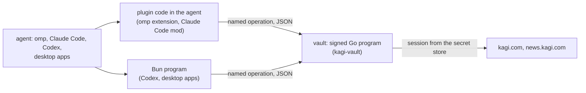

# Security

What the plugins protect at run time, where the boundaries are, and what is out of scope. How
this repository checks its own changes is the workspace's business, not covered here.

## What is protected

- A person's service credentials: today, piebird-kagi-search's Kagi session (the token in a
  Kagi Session Link), which signs searches in as that subscriber and can change their account.
- What the plugins read on the person's computer: piebird-sessions reads the agents' own session
  journals, piebird-threads its threads folder. Both only read and write locally; nothing is
  sent anywhere but to the agent the person is talking to.

## Who holds a secret

- **Plugin code in the agent** (an omp extension, a Claude Code mod) runs with the agent's own
  permissions and holds no secret. It reaches a service through the vault's named operations.
- **The Bun program** (`native/<plugin>`, for Codex and the desktop apps, which run no plugin
  code) holds no secret either. Any program running as the person can run its own code as a Bun
  program (`BUN_BE_BUN`, `BUN_OPTIONS`), so nothing secret may live in one. It is built with
  `--no-compile-autoload-bunfig` and `--no-compile-autoload-dotenv`, so a `bunfig.toml` or `.env`
  in the folder it runs in can't inject code into it.
- **The vault** (`native/kagi-vault`, one signed Go program per service) is the only thing that
  holds and uses the secret. It keeps the session in the system's secret store, makes the
  service's requests itself, and returns parsed results, never the session.

## The vault

- **Named operations only.** Each operation (`search`, `quick`, `news-search`, `status`, ...)
  is declared in the plugin's `core/operations.json`, with fixed URLs in its code. There is no
  generic signed-in fetch: a request of the caller's choosing could reach a page that reflects
  the session, or follow a redirect elsewhere with it.
- **Raw read and raw write**, the one exception, for what the named operations don't cover:
  limited to kagi.com and news.kagi.com; no redirect is followed; the session goes to kagi.com
  alone and a request can't set `Cookie` or `Host`; a read is GET only and never signs out; the
  answer never carries the session token (as written or URL-encoded) nor a cookie Kagi sets. An
  account change through raw write stays possible by design: the agent can be told to make one,
  including by text it reads (prompt injection).
- **What it trusts is compiled in.** The settings and secrets it accepts are generated from the
  plugin's declarations and embedded at build time; editing a file next to it widens nothing.
- **Where the session is kept.** macOS: the Keychain, as an item of the vault's own signed
  identity, so another program asking for it gets a prompt. Windows: Credential Manager; Linux:
  the Secret Service (GNOME Keyring, KWallet). Both keep a secret per person, not per program:
  any program running as that person can read it. Where no store runs (servers, containers), a
  file only its owner can read, in a folder only they can open.
- **Sign-in.** The Session Link goes from the person's browser to a page the vault serves on
  127.0.0.1, behind a random path, refusing any other host name (a site in the browser could
  otherwise reach it through a name it controls) and never cached; then into the secret store.
  It never passes through the agent's chat.
- **Settings** hold no secrets. The settings page (`<program> settings`, the installer's page)
  is served the same way as the sign-in page and writes only the person's settings file.

## Builds

The native programs are built from this repository's source by its release workflow, macOS
builds signed and notarized; nothing is downloaded at run time. A program is installed, updated
and removed with its plugin.

The desktop installer (docs/installer.md) carries the plugins it installs, built the same way;
it downloads nothing. It writes into the agents' own settings only what their own commands
would, never replaces those files, and leaves a piebird marketplace from elsewhere alone. Its
page names what to do from a list the installer made, never a path or a command, and is served
the same way as the sign-in page. It doesn't pre-trust Codex hooks.

## Out of scope

- Other programs running as the same person: they can read a secret from Credential Manager, the
  Secret Service or the file, run code as the Bun program, and drive the agent itself.
- `KAGI_SESSION_TOKEN` set on purpose: the vault uses it instead of the stored session.
- What the agent does with what a tool returns: search results and pages are untrusted text.
- Windows builds are unsigned until the code-signing certificate arrives.
